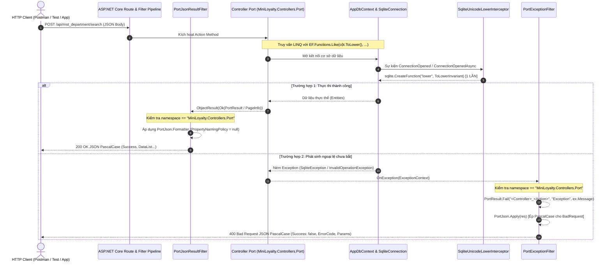

# KIẾN TRÚC HẠ TẦNG DÙNG CHUNG (SHARED INFRASTRUCTURE) — MiniLoyalty

> **Phạm vi**: Đặc tả chi tiết cơ chế, nguyên lý thiết kế và mã nguồn thực tế của các thành phần hạ tầng dùng chung cho toàn bộ các controller port 1-1: `PortFilters`, `PortJson`, `PortJsonResultFilter`, `PortExceptionFilter`, `SqliteUnicodeLowerInterceptor`.  
> **Cập nhật**: 2026-10-16 12:00  
> **Nguồn dữ liệu**: Đọc mã nguồn thực tế từ `Data/PortFilters.cs`, `Data/SqliteUnicodeLower.cs`, `Data/PortResult.cs`, và `Program.cs` tại HEAD commit `02911b1` của repository `MiniLoyalty`.  
> **Trạng thái**: Nháp — chờ review  

---

## 1. Bối cảnh & Mục tiêu thiết kế

Trong quá trình chuyển đổi (port) 1-1 từ giải pháp nguồn `2022.7.Loyalty` sang ứng dụng đích `MiniLoyalty`, các kiểm thử độc lập từ đội ngũ QA (`qa1`, `qa2`) đã phát hiện nhiều lỗi hệ thống mang tính chất diện rộng:
1. **Lỗi định dạng JSON (QA-qa1-5)**: Hệ thống nguồn serialize bằng `JavaScriptSerializer` và Newtonsoft.Json trả về trường PascalCase (`Success`, `Data`, `DataList`, `ItemCount`, `ErrorCode`, `Params`). ASP.NET Core 8 Web API mặc định cấu hình `JsonNamingPolicy.CamelCase`, làm sai lệch hoàn toàn hợp đồng giao tiếp với các client cũ.
2. **Lỗi sập HTTP 500 do ngoại lệ chưa bắt (QA-qa1-4, QA-qa2-1, QA-qa2-2/3)**: Các action đọc hoặc các thao tác cơ sở dữ liệu khi phát sinh lỗi không lường trước làm sập tiến trình hoặc trả về HTTP 500 kèm stack trace HTML, trong khi nguồn luôn bắt ngoại lệ tại Gate và trả về HTTP 400 với `Success = false`.
3. **Lỗi tìm kiếm tiếng Việt HOA có dấu trên SQLite (QA-qa1-1)**: Hàm `lower()` mặc định của SQLite chỉ hạ chữ cho ký tự ASCII. Khi tìm kiếm các từ khóa tiếng Việt chữ hoa như `ĐÀ NẴNG` hay `ĐỘC`, SQLite trả về 0 dòng dù dữ liệu tồn tại. Các agent viết mã từng cố gắng tự đăng ký hàm `sqlite.CreateFunction("lower", ...)` lặp đi lặp lại trong action gây xung đột tài nguyên (#152, #153).

Nếu để từng agent viết code xử lý các vấn đề trên một cách cục bộ trong từng file controller riêng biệt, hệ thống sẽ rơi vào tình trạng phân mảnh, vi phạm nguyên tắc DRY (Don't Repeat Yourself), và tiềm ẩn nguy cơ xung đột mã nguồn khi nhiều agent chạy song song.

Do đó, commit `02911b1` đã thiết lập **bộ hạ tầng dùng chung tập trung** (Shared Infrastructure) tại thư mục [`Data/`](../../Data/), đăng ký một lần duy nhất tại [`Program.cs`](../../Program.cs), tự động bảo vệ toàn bộ các endpoint thuộc namespace `MiniLoyalty.Controllers.Port` mà không làm ảnh hưởng đến các API cũ hoặc giao diện SPA.

---

## 2. Sơ đồ chu trình xử lý yêu cầu qua tầng hạ tầng chung



---

## 3. Đặc tả chi tiết từng thành phần hạ tầng

### 3.1. `PortJson` & `PortJsonResultFilter` — Chuẩn hóa PascalCase có chọn lọc

- **Tệp nguồn**: [`Data/PortFilters.cs:19-51`](../../Data/PortFilters.cs#L19-L51)
- **Đăng ký tại**: [`Program.cs:33`](../../Program.cs#L33) qua `o.Filters.Add<PortJsonResultFilter>()`.

#### Mã nguồn chi tiết của `PortJson`:
```csharp
// Data/PortFilters.cs:19-40
public static class PortJson
{
    public const string PortNamespace = "MiniLoyalty.Controllers.Port";

    // PropertyNamingPolicy = null => giữ nguyên tên thuộc tính C# (PascalCase).
    // Encoder nới lỏng: không escape ký tự tiếng Việt.
    public static readonly SystemTextJsonOutputFormatter Formatter = new(new JsonSerializerOptions
    {
        PropertyNamingPolicy = null,
        DictionaryKeyPolicy = null,
        Encoder = JavaScriptEncoder.UnsafeRelaxedJsonEscaping,
        TypeInfoResolver = new System.Text.Json.Serialization.Metadata.DefaultJsonTypeInfoResolver(),
    });

    public static bool IsPort(ActionDescriptor? d) =>
        d is ControllerActionDescriptor cad && cad.ControllerTypeInfo.Namespace == PortNamespace;

    public static void Apply(ObjectResult r)
    {
        r.Formatters.Clear();
        r.Formatters.Add(Formatter);
    }
}
```

#### Mã nguồn chi tiết của `PortJsonResultFilter`:
```csharp
// Data/PortFilters.cs:43-51
public sealed class PortJsonResultFilter : IResultFilter
{
    public void OnResultExecuting(ResultExecutingContext context)
    {
        if (PortJson.IsPort(context.ActionDescriptor) && context.Result is ObjectResult o) 
            PortJson.Apply(o);
    }

    public void OnResultExecuted(ResultExecutedContext context) { }
}
```

#### Phân tích kỹ thuật & Tính cô lập:
1. **Kiểm tra định danh namespace**: Phương thức `PortJson.IsPort()` ([`Data/PortFilters.cs:32-33`](../../Data/PortFilters.cs#L32-L33)) kiểm tra chính xác namespace của Controller đang thực thi. Chỉ các controller thuộc `MiniLoyalty.Controllers.Port` mới chịu tác động.
2. **Cấu hình Formatter chuyên biệt**: Thay vì ghi đè naming policy toàn cục trong `builder.Services.Configure<JsonOptions>`, `PortJson` tạo riêng một thể hiện `SystemTextJsonOutputFormatter` với `PropertyNamingPolicy = null`.
3. **Bảo tồn ký tự tiếng Việt**: Thuộc tính `Encoder = JavaScriptEncoder.UnsafeRelaxedJsonEscaping` ngăn chặn việc các ký tự Unicode tiếng Việt bị mã hóa thành chuỗi escape dạng `\u00e0`, `\u1edf`, giữ cho payload JSON trả về trong sáng và nhẹ hơn.
4. **Cô lập kiến trúc**: Toàn bộ các API nguyên bản của MiniLoyalty (`/api/v1/*`, `/api/earn`, `/healthz`) và các controller phục vụ SPA vẫn tuân thủ định dạng camelCase chuẩn của .NET 8. Điều này loại bỏ hoàn toàn nguy cơ làm gãy các ứng dụng frontend hiện hữu.

---

### 3.2. `PortExceptionFilter` — Chuyển đổi ngoại lệ thành HTTP 400

- **Tệp nguồn**: [`Data/PortFilters.cs:54-67`](../../Data/PortFilters.cs#L54-L67)
- **Đăng ký tại**: [`Program.cs:34`](../../Program.cs#L34) qua `o.Filters.Add<PortExceptionFilter>()`.

#### Mã nguồn chi tiết của `PortExceptionFilter`:
```csharp
// Data/PortFilters.cs:54-67
public sealed class PortExceptionFilter : IExceptionFilter
{
    public void OnException(ExceptionContext context)
    {
        if (context.ExceptionHandled || !PortJson.IsPort(context.ActionDescriptor)) return;
        var cad = (ControllerActionDescriptor)context.ActionDescriptor;
        
        // Mã lỗi kiểu nguồn: "<Controller bỏ hậu tố Controller/Port>_<Action>", vd Mst_Department_Search.
        var ctrl = cad.ControllerTypeInfo.Name.Replace("ControllerPort", "").Replace("Controller", "");
        var res = PortResult.Fail($"{ctrl}_{cad.ActionName}", "Exception", context.Exception.Message);
        
        // Result filter KHÔNG chạy khi exception filter xử lý ngoại lệ → tự áp PascalCase
        PortJson.Apply(res);
        context.Result = res;
        context.ExceptionHandled = true;
    }
}
```

#### Phân tích kỹ thuật & Hợp đồng lỗi:
1. **Chuẩn hóa mã lỗi theo nguồn**: Tên controller được chuẩn hóa bằng cách loại bỏ các hậu tố `ControllerPort` hoặc `Controller` ([`Data/PortFilters.cs:61`](../../Data/PortFilters.cs#L61)). Khi action `Search` của `Mst_DepartmentControllerPort` phát sinh lỗi, mã lỗi sinh ra sẽ là `ErridnLoyalty.Mst_Department_Search`.
2. **Tương thích với `PortResult.Fail`**: Hàm gọi [`PortResult.Fail`](../../Data/PortResult.cs#L17-L23) để đóng gói lỗi vào cấu trúc chuẩn:
   ```json
   {
     "Success": false,
     "ErrorCode": "ErridnLoyalty.Mst_Department_Search",
     "Params": {
       "Exception": "<Nội dung ex.Message>"
     }
   }
   ```
3. **Khắc phục bẫy pipeline của ASP.NET Core**: Khi một Exception Filter xử lý ngoại lệ và gán `context.ExceptionHandled = true`, luồng pipeline của ASP.NET Core sẽ **bỏ qua** các `IResultFilter`. Do đó, dòng lệnh `PortJson.Apply(res)` tại [`Data/PortFilters.cs:63`](../../Data/PortFilters.cs#L63) là bắt buộc để đảm bảo phản hồi lỗi vẫn giữ đúng định dạng PascalCase.
4. **Phân định trách nhiệm giữa Filter và Controller (Quy tắc Transaction)**:
   - `PortExceptionFilter` là chốt chặn cuối cùng bảo vệ hệ thống không bị crash hoặc trả về HTTP 500 khi xảy ra lỗi bất ngờ (đặc biệt ở các action ĐỌC như Search, GetAllActive, GetById).
   - Tại các action GHI (Create, Update, Delete, Import) có sử dụng database transaction (`await db.Database.BeginTransactionAsync()`), lập trình viên **bắt buộc phải bọc khối `try/catch` cục bộ** để thực hiện `await tx.RollbackAsync()` trước khi trả về `PortResult.Fail(...)`. **CẤM dùng `throw;`** vì sẽ làm mất rollback có kiểm soát.

---

### 3.3. `SqliteUnicodeLowerInterceptor` — Hỗ trợ Unicode cho SQLite

- **Tệp nguồn**: [`Data/SqliteUnicodeLower.cs:14-30`](../../Data/SqliteUnicodeLower.cs#L14-L30)
- **Đăng ký tại**: [`Program.cs:24`](../../Program.cs#L24) trong cấu hình `AddDbContext<AppDbContext>`.

#### Mã nguồn chi tiết của `SqliteUnicodeLowerInterceptor`:
```csharp
// Data/SqliteUnicodeLower.cs:14-30
public sealed class SqliteUnicodeLowerInterceptor : DbConnectionInterceptor
{
    public override void ConnectionOpened(DbConnection connection, ConnectionEndEventData eventData)
        => Register(connection);

    public override Task ConnectionOpenedAsync(DbConnection connection, ConnectionEndEventData eventData, CancellationToken cancellationToken = default)
    {
        Register(connection);
        return Task.CompletedTask;
    }

    private static void Register(DbConnection connection)
    {
        if (connection is SqliteConnection sqlite)
            sqlite.CreateFunction<string?, string?>("lower", value => value?.ToLowerInvariant(), isDeterministic: true);
    }
}
```

#### Phân tích kỹ thuật & Nguyên lý hoạt động:
1. **Can thiệp cấp kết nối (Connection Interceptor)**: Kế thừa từ `DbConnectionInterceptor` của EF Core, lớp này bắt chặn cả hai sự kiện mở kết nối đồng bộ (`ConnectionOpened`) và bất đồng bộ (`ConnectionOpenedAsync`).
2. **Ghi đè hàm nội tại `lower`**: Hàm `Register()` kiểm tra nếu kết nối là `Microsoft.Data.Sqlite.SqliteConnection` thì sẽ đăng ký một hàm người dùng tự định nghĩa (User-Defined Function - UDF) trùng tên `lower`.
3. **Triển khai hạ chữ Unicode chuẩn**: Delegate `value => value?.ToLowerInvariant()` sử dụng bộ quy tắc hạ chữ Unicode đầy đủ của thư viện .NET Core. Ký tự `Đ` sẽ được chuyển đổi chính xác thành `đ`, `Â` thành `â`, `Ơ` thành `ơ`. Cờ `isDeterministic = true` cho phép bộ tối ưu hóa truy vấn của SQLite lưu cache kết quả để tăng tốc xử lý.
4. **Đồng bộ hai phía LINQ và SQL**:
   - Phía C#: Chuỗi tìm kiếm được xử lý bằng `keyword.Trim().ToLowerInvariant()`.
   - Phía SQL: Biểu thức LINQ `cột.ToLower()` được EF Core dịch thành lời gọi hàm `lower("cột")`. Nhờ UDF đã đăng ký, hàm này trả về chuỗi hạ chữ Unicode, khớp tuyệt đối với phía C#.
5. **Loại bỏ hoàn toàn mã cục bộ**: Mọi controller port hiện tại không còn phải tự quản lý kết nối SQLite hay tự đăng ký UDF. Điều này khắc phục dứt điểm bài học A.1 trong `LESSONS_AGENTS.md`.

---

## 4. Tích hợp tại điểm khởi động `Program.cs`

Mã nguồn tại [`Program.cs:18-35`](../../Program.cs#L18-L35) thể hiện cách kết nối toàn bộ các thành phần hạ tầng trên vào ứng dụng:

```csharp
// Program.cs:18-35
builder.Services.AddDbContext<AppDbContext>(o =>
{
    if (DbUtil.IsPostgres(conn)) o.UseNpgsql(DbUtil.ToNpgsql(conn));
    else
    {
        o.UseSqlite(conn);
        o.AddInterceptors(new SqliteUnicodeLowerInterceptor());   // lower() hiểu Unicode (tìm kiếm tiếng Việt có dấu)
    }
});
builder.Services.AddScoped<ITenantContext, TenantContext>();
builder.Services.AddScoped<ILoyaltyService, LoyaltyService>();
builder.Services.AddFleetObs();
builder.Services.AddControllersWithViews(o =>
{
    // Chỉ tác động controller port 1:1 (namespace MiniLoyalty.Controllers.Port): 
    // JSON PascalCase như nguồn + ngoại lệ → 400 PortResult.Fail.
    o.Filters.Add<PortJsonResultFilter>();
    o.Filters.Add<PortExceptionFilter>();
});
```

---

## 5. Đánh giá rủi ro an toàn & Định hướng tương lai

### 5.1. Rủi ro lộ chi tiết ngoại lệ (`ex.Message`)
- **Hiện trạng**: `PortExceptionFilter` trả nguyên văn `context.Exception.Message`. Điều này đạt tính tương thích 1-1 với nguồn, phục vụ kiểm thử đối chiếu rất tốt.
- **Rủi ro**: Nếu đưa ra mạng Internet công khai, các thông báo lỗi cú pháp SQL hoặc cấu trúc bảng có thể bị kẻ tấn công khai thác để phân tích lỗ hổng (SQL Injection, schema probing).
- **Đề xuất khắc phục**: Khi triển khai production, cấu hình môi trường kiểm tra `app.Environment.IsProduction()`: nếu là production, chỉ ghi log chi tiết vào Seq/Serilog và trả về thông điệp an toàn cho client.

### 5.2. Chống phân mảnh kiến trúc
Nhờ 3 thành phần hạ tầng trên, các lập trình viên và agent AI tiếp theo khi thực hiện port 215 endpoint còn lại chỉ cần tuân thủ 3 nguyên tắc đơn giản:
1. Đặt Controller đúng trong namespace `MiniLoyalty.Controllers.Port`.
2. Sử dụng `EF.Functions.Like(cột.ToLower(), pattern, "\\")` cho tìm kiếm chuỗi.
3. Bọc `try/catch` có `tx.RollbackAsync()` ở các hàm ghi có transaction; để `PortExceptionFilter` tự động bắt các lỗi đọc và ngoại lệ không dự liệu trước.

---

## 6. Lịch sử cập nhật

| Phiên bản | Ngày cập nhật | Người thực hiện | Nội dung thay đổi |
|---|---|---|---|
| 1.0 | 2026-10-16 12:00 | doc2 (Quản lý quy trình) | Khởi tạo tài liệu kiến trúc hạ tầng dùng chung cho controller port 1-1; phân tích chuyên sâu PortFilters, PortJson, PortExceptionFilter và SqliteUnicodeLowerInterceptor với trích dẫn mã nguồn thật. |
