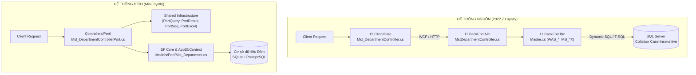

# Kiến trúc Tổng quan MiniLoyalty Port 1-1

| Thông tin | Giá trị |
|---|---|
| **Phạm vi** | Kiến trúc tổng quan hệ thống port 1-1, đối chiếu các tầng nguồn - đích, hạ tầng chia sẻ, cơ chế tự sinh schema và cấu hình vận hành |
| **Cập nhật** | 2026-10-16 |
| **Phiên bản mã** | 8b25ecf |
| **Trạng thái** | Nháp — chờ review |

---

## 1. Mô hình Kiến trúc: Nguồn vs. Đích

Quá trình chuyển đổi (porting) chuyển đổi kiến trúc phân tán đa tầng phức tạp của dự án nguồn `2022.7.Loyalty` sang kiến trúc ASP.NET Core 8 Web API thu gọn (monolithic compact) trong dự án `MiniLoyalty` (thư mục gốc của repository).

### 1.1. Chuỗi gọi ở hệ thống nguồn (`2022.7.Loyalty`)

Ở hệ thống nguồn, một yêu cầu API đi qua 4 tầng vật lý độc lập:

1. **Tầng Gate (Client Gate API)**:
   - Đường dẫn mã nguồn: `D:\idocNet\2022.7.Loyalty\13.ClientGate\V10\idn.Loyalty.WebAPI\Controllers\<X>Controller.cs`
   - Nhiệm vụ: Tiếp nhận yêu cầu HTTP từ client, kiểm tra xác thực cổng (`CheckGatewayAuthentication`), giải mã token, kiểm tra quyền truy cập (`CheckAuthorize`), trích xuất thông tin người dùng đang đăng nhập (`orgUserUI`), đóng gói tham số vào đối tượng `WARQBase` và gọi service tầng WebAPI.
2. **Tầng API Backend (Backend Service Controller)**:
   - Đường dẫn mã nguồn: `D:\idocNet\2022.7.Loyalty\11.BackEnd\V10\idn.Loyalty.Biz.Web\Controllers\<X>Controller.cs` (tên controller không có dấu gạch dưới).
   - Nhiệm vụ: Nhận request qua WCF / HTTP, kiểm tra session backend (`CheckAuthentication`), định tuyến đến lớp xử lý nghiệp vụ (`idn.Loyalty.Biz`).
3. **Tầng Biz (Business Logic Layer)**:
   - Đường dẫn mã nguồn: `D:\idocNet\2022.7.Loyalty\11.BackEnd\V10\idn.Loyalty.Biz\Master*.cs`
   - Nhiệm vụ: Kiểm tra toàn bộ quy tắc nghiệp vụ (guards), kiểm tra trùng lặp hoặc hợp lệ trên DB qua các hàm `*_CheckDB`, quản lý transaction (`_cf.db.BeginTransaction()`), ném ngoại lệ nghiệp vụ qua `CmUtils.CMyException.Raise(TError.ErridnLoyalty.<MãLỗi>, ...)` và dựng câu lệnh SQL.
4. **Tầng Cơ sở dữ liệu (Data Access / SQL Server)**:
   - Hệ quản trị CSDL: Microsoft SQL Server, cấu hình Collation không phân biệt hoa thường (`SQL_Latin1_General_CP1_CI_AS`).
   - Xử lý câu lệnh SQL động qua `CmUtils.SqlUtils.BuildWhere` hoặc các Stored Procedures.

### 1.2. Chuỗi xử lý ở hệ thống đích (`MiniLoyalty`)

Tại hệ thống đích, toàn bộ chuỗi được gói gọn trong kiến trúc thống nhất, loại bỏ chi phí gọi qua mạng nội bộ giữa Gate - API - Biz:

1. **Tầng Controller Port**:
   - Vị trí: [`Controllers/Port/<TênControllerNguồn>Port.cs`](../../Controllers/Port/) (ví dụ: [`Mst_DepartmentControllerPort.cs`](../../Controllers/Port/Mst_DepartmentControllerPort.cs)).
   - Định tuyến: Đánh dấu `[ApiController]`, route chuẩn hóa `/api/<tên-controller-nguồn-chữ-thường>/<action>` (ví dụ: `POST /api/mst_department/search`).
   - Xử lý: Đóng gói đồng thời vai trò kiểm tra tính hợp lệ tại gate và thực thi toàn bộ logic nghiệp vụ (thay thế cho chuỗi Gate → API → Biz của nguồn).
2. **Tầng Entity Framework Core & Tự động cấu hình**:
   - Vị trí Entity: [`Models/Port/<TênBảng>.cs`](../../Models/Port/) (ví dụ: [`Mst_Department.cs`](../../Models/Port/Mst_Department.cs)).
   - Quản trị ánh xạ: Triển khai giao diện `IEntityTypeConfiguration<T>` ngay trong cùng file entity. [`AppDbContext`](../../Data/AppDbContext.cs#L78) tự động đăng ký thông qua `ApplyConfigurationsFromAssembly`.
   - Truy vấn: Sử dụng `db.Set<T>()` trực tiếp mà không cần khai báo thuộc tính `DbSet<T>` tĩnh trên context, ngăn chặn xung đột merge code giữa các lập trình viên.
3. **Tầng Cơ sở dữ liệu linh hoạt (SQLite & PostgreSQL)**:
   - SQLite phục vụ phát triển, chạy kiểm thử cục bộ độc lập và verify nhanh.
   - PostgreSQL phục vụ môi trường triển khai thực tế trên cloud (Render).



---

## 2. Các Thành phần Dùng chung (Shared Infrastructure)

Toàn bộ các helper hạ tầng chia sẻ được đặt tại thư mục [`Data/`](../../Data/) nhằm bảo đảm các controller port xử lý đồng nhất về ngữ nghĩa dữ liệu, collation và khuôn phản hồi lỗi.

### 2.1. `PortInfra` & `IPortSeeder`

- **Tệp nguồn**: [`Data/PortInfra.cs:1-21`](../../Data/PortInfra.cs#L1-L21)
- **Mục đích**:
  - Đặt ra nguyên tắc kiến trúc module hóa: Mỗi bảng/màn hình đặt trong một file riêng biệt thuộc namespace `MiniLoyalty.Models.Port`.
  - Không sửa đổi trực tiếp [`Data/AppDbContext.cs`](../../Data/AppDbContext.cs) hay [`Data/Seeder.cs`](../../Data/Seeder.cs) để nhiều luồng phát triển có thể làm việc song song mà không xung đột git merge.
- **Giao diện `IPortSeeder`** ([`Data/PortInfra.cs:14-20`](../../Data/PortInfra.cs#L14-L20)):
  - Yêu cầu mọi class seeder phải có tính **idempotent** (chỉ seed khi bảng chưa có dữ liệu: `if (await db.Set<T>().AnyAsync()) return;`).
  - Định nghĩa thuộc tính thứ tự thực thi `int Order => 100`:
    - Danh mục hệ thống (`Mst_*`): dùng khoảng `10` đến `99` (ví dụ: [`Mst_DepartmentSeeder.Order = 32`](../../Models/Port/Mst_Department.cs#L74)).
    - Bản đồ liên kết & cấu hình (`Map_*`, `Sys_*`): dùng khoảng `100` đến `199`.
    - Nghiệp vụ giao dịch (`Crd_*`, `Prm_*`): dùng từ `200` trở lên.

### 2.2. `PortQuery` & `PageInfo<T>`

- **Tệp nguồn**: [`Data/PortQuery.cs:1-32`](../../Data/PortQuery.cs#L1-L32)
- **Vấn đề giải quyết**:
  - SQL Server nguồn sử dụng collation CI (`Case-Insensitive`). Tại hệ thống đích, toán tử so sánh chuỗi mặc định `==` hoặc `.Contains()` trong LINQ chuyển thành hàm `instr` trên SQLite hoặc so sánh phân biệt hoa thường trên Postgres, dẫn đến việc tìm kiếm chuỗi khác chữ hoa/thường trả về 0 dòng (lỗi câm).
- **Giải pháp kỹ thuật**:
  - Hạ chữ cả hai phía và sử dụng `EF.Functions.Like(...)` kết hợp ký tự thoát đặc biệt [`PortQuery.Esc = "\\"`](../../Data/PortQuery.cs#L16).
  - [`PortQuery.Contains(string value)`](../../Data/PortQuery.cs#L19): Mô phỏng toán tử `LIKE '%x%'` của nguồn bằng cách escape `%`, `_`, `\` và bọc hai đầu bằng ký tự `%`.
  - [`PortQuery.Equal(string value)`](../../Data/PortQuery.cs#L22): Mô phỏng toán tử `= 'x'` không phân biệt hoa thường bằng cách escape ký tự đại diện và không thêm wildcard `%`.
- **Khuôn phân trang `PageInfo<T>`** ([`Data/PortQuery.cs:31`](../../Data/PortQuery.cs#L31)):
  - Chuẩn hóa đầu ra phân trang tương thích `TModelsUI.PageInfo<T>` tầng gate: `(DataList, ItemCount, PageCount, PageIndex, PageSize)`.

### 2.3. `PortResult`

- **Tệp nguồn**: [`Data/PortResult.cs:1-25`](../../Data/PortResult.cs#L1-L25)
- **Cơ chế**:
  - Nguồn ném ngoại lệ `CmUtils.CMyException.Raise(TError.ErridnLoyalty.<MãLỗi>, null, alParamsCoupleError)` rồi gate đóng gói thành `Success = false`.
  - Ở đích, [`PortResult.Fail(string errorCode, params object?[] paramCouples)`](../../Data/PortResult.cs#L17-L23) trả về HTTP 400 (`BadRequestObjectResult`) với cấu trúc:
    ```json
    {
      "Success": false,
      "ErrorCode": "ErridnLoyalty.<MãLỗi>",
      "Params": {
        "TênThamSố1": "GiáTrị1",
        "TênThamSố2": "GiáTrị2"
      }
    }
    ```
  - Cấu trúc này đảm bảo đối soát lỗi 1-1 với toàn bộ mã lỗi `ErridnLoyalty.*` của hệ thống gốc.

### 2.4. `PortSeq`

- **Tệp nguồn**: [`Data/PortSeq.cs:1-63`](../../Data/PortSeq.cs#L1-L63)
- **Cơ chế**:
  - Mô phỏng tiện ích sinh sequence `Seq.cs:28-41, 137, 152-185` của nguồn.
  - [`PortSeq.Build(...)`](../../Data/PortSeq.cs#L27-L38): Định dạng sequence theo mẫu (ví dụ: `"{0}DPMCODE.{3}.{1:00000}{2}"`). Thành phần `{3}` là chuỗi 3 ký tự mã hóa thời gian UTC dựa trên năm gốc 2010 (`DefaultRootYear = 2010`), tháng và ngày qua bảng ký tự `0-9A-Z` gồm 36 ký tự.
  - [`PortSeq.NextAsync<TSeq>(AppDbContext db)`](../../Data/PortSeq.cs#L44-L61): Thực hiện thêm bản ghi vào bảng sequence trong một **Transaction độc lập đã commit ngay**, trích xuất `AutoId`, sau đó xóa bản ghi tạm. Cơ chế commit độc lập bảo đảm số sequence luôn tăng liên tục và không bị rollback ngay cả khi nghiệp vụ chính gặp lỗi hoặc hủy bỏ.

### 2.5. `PortExcel`

- **Tệp nguồn**: [`Data/PortExcel.cs:1-109`](../../Data/PortExcel.cs#L1-L109)
- **Cơ chế**:
  - Thay thế thư viện DLL `ExcelExport` và `ExcelImportNew` của nguồn bằng thư viện `ClosedXML`.
  - [`GenExcelExportFilePath`](../../Data/PortExcel.cs#L18-L34): Tạo đường dẫn ảo lưu file xuất dạng `/TempFiles/yyyy-MM-dd/{prefix}_{yyMMddHHmmss}[_i].xlsx` dưới thư mục `wwwroot` khớp chuẩn `BaseController.cs:772-790`.
  - [`ExportToExcelFromList`](../../Data/PortExcel.cs#L40-L70): Xuất danh sách đối tượng ra bảng tính theo danh mục nhãn cột.
  - [`ReadSheet`](../../Data/PortExcel.cs#L79-L99): Đọc dữ liệu từ file Excel upload (stream), bắt đầu từ hàng dữ liệu thứ 2 (`A2`), ánh xạ các cột theo thứ tự khóa từ điển mẫu import.
  - [`GetRequestBaseAddress`](../../Data/PortExcel.cs#L102-L107): Xác định domain/port của request hiện tại để ghép thành URL tải file đầy đủ.

---

## 3. Cơ chế Tự động Tạo Bảng và Bổ sung Cột (Dynamic Schema Management)

Khi hệ thống mở rộng liên tục qua nhiều hạng mục port song song, việc quản lý migration truyền thống của EF Core dễ phát sinh xung đột snapshot. Hệ thống giải quyết vấn đề này qua cơ chế tự động quản lý schema động tại [`Data/Seeder.cs:101-196`](../../Data/Seeder.cs#L101-L196).

### 3.1. Hạn chế của `EnsureCreatedAsync` (Bẫy #28)

Phương thức chuẩn `db.Database.EnsureCreatedAsync()` của EF Core **chỉ tạo cơ sở dữ liệu và bảng khi cơ sở dữ liệu chưa tồn tại**. Nếu file database SQLite hoặc schema PostgreSQL đã tồn tại từ trước, `EnsureCreatedAsync` hoàn toàn không thực hiện bất kỳ thao tác nào (no-op), khiến các bảng entity mới bổ sung không thể được tạo.

### 3.2. Cơ chế `EnsureNewTablesAsync` ([`Data/Seeder.cs:101-154`](../../Data/Seeder.cs#L101-L154))

Để khắc phục, hàm `EnsureNewTablesAsync` được gọi trong quá trình khởi động ứng dụng:
1. Quét toàn bộ metadata EF Core qua `db.Model.GetEntityTypes()`.
2. Lọc tất cả các entity thuộc namespace `MiniLoyalty.Models.Port` hoặc các bảng kế thừa.
3. Tự động sinh câu lệnh DDL `CREATE TABLE IF NOT EXISTS` dựa trên metadata EF của từng thuộc tính:
   - Tên bảng và tên cột được trích xuất trực tiếp từ model configuration.
   - Kiểu cột lưu trữ (`StoreType`) được suy diễn chính xác cho từng database provider.
   - Xử lý khóa chính tự tăng (`ValueGenerated.OnAdd`):
     - PostgreSQL: Sinh cú pháp `bigint GENERATED BY DEFAULT AS IDENTITY PRIMARY KEY`.
     - SQLite: Sinh cú pháp `INTEGER NOT NULL PRIMARY KEY AUTOINCREMENT`.
4. Thực thi an toàn qua `ExecuteSqlRawAsync`.

### 3.3. Cơ chế `AddMissingColumnsAsync` (Bẫy #47, [`Data/Seeder.cs:160-196`](../../Data/Seeder.cs#L160-L196))

Trong trường hợp một bảng đã tồn tại từ đợt port trước, nhưng ở các hạng mục tiếp theo bảng đó được bổ sung thêm thuộc tính mới:
1. Truy vấn danh sách cột hiện có trong database:
   - PostgreSQL: Tra cứu qua bảng `information_schema.columns`.
   - SQLite: Tra cứu qua lệnh pragma `pragma_table_info(@t)`.
2. Đối chiếu với danh sách properties của entity trong metadata EF Core.
3. Nếu phát hiện cột có trong entity nhưng chưa có trong database, hệ thống tự động chạy lệnh:
   ```sql
   ALTER TABLE "<TableName>" ADD COLUMN "<ColumnName>" <StoreType> NULL
   ```
4. **Lưu ý quy tắc**: Cột thêm mới luôn cho phép `NULL` vì SQLite không cho phép `ALTER TABLE ... ADD COLUMN ... NOT NULL` khi bảng đã chứa dữ liệu mà không có giá trị mặc định.

---

## 4. Cấu hình Hệ thống & Biến Môi trường

Ứng dụng nạp các tham số cấu hình từ biến môi trường (Environment Variables) hoặc file cấu hình [`appsettings.json`](../../appsettings.json), được xử lý tại [`Program.cs`](../../Program.cs):

| Tham số / Biến | Nguồn cấu hình | Giá trị mặc định | Mục đích & Ứng dụng |
|---|---|---|---|
| `PORT` | `Environment.GetEnvironmentVariable("PORT")` ([`Program.cs:13`](../../Program.cs#L13)) | `"8080"` | Cổng lắng nghe HTTP của dịch vụ Web API: `builder.WebHost.UseUrls($"http://0.0.0.0:{port}")`. |
| `CONNECTION_STRING` | `Environment.GetEnvironmentVariable("CONNECTION_STRING")` hoặc `DefaultConnection` ([`Program.cs:16-17`](../../Program.cs#L16-L17)) | `"Data Source=miniloyalty.db"` | Chuỗi kết nối CSDL. Hệ thống tự nhận diện PostgreSQL nếu chuỗi bắt đầu bằng `postgres://`/`postgresql://` qua [`DbUtil.IsPostgres`](../../Data/DbUtil.cs#L10), ngược lại dùng SQLite. |
| `Biz_OrgID` | `IConfiguration["Biz_OrgID"]` (Controller Port) | `null` | Xác định mã tổ chức mặc định khi chưa có phiên đăng nhập của người dùng. Áp dụng khi gọi `GetAllActive` (nếu null thì lấy tất cả tổ chức), và dùng để trích xuất `OrgID_UC` / `MST_UC` khi thực hiện `Create` hoặc `Import`. |
| `Biz_NetworkID` | `IConfiguration["Biz_NetworkID"]` (Controller Port) | `"1001"` | Xác định mã mạng nghiệp vụ mặc định khi tạo mới bản ghi nếu chưa có phiên người dùng (thay thế cho `orgUserUI.NetworkId`). |
| `SSO_AUTHORITY` | `Environment.GetEnvironmentVariable("SSO_AUTHORITY")` ([`Program.cs:33`](../../Program.cs#L33)) | `"https://minisso.onrender.com"` | Địa chỉ cấp phép xác thực SSO của hệ thống liên kết. |

---

## 5. Quy chuẩn Đóng gói Module Port 1-1

Khi tạo mới một module port 1-1, cấu trúc bắt buộc tuân theo:

1. **Entity**: [`Models/Port/<TênBảng>.cs`](../../Models/Port/)
   - Chứa lớp Entity (POCO) đúng số lượng cột của bảng nguồn.
   - Chứa lớp cấu hình `IEntityTypeConfiguration<T>` thiết lập tên bảng (`ToTable`) và khóa chính (`HasKey`).
   - Chứa lớp `IPortSeeder` khởi tạo dữ liệu mẫu tối thiểu để chạy được API.
   - Nếu module sử dụng sequence tự sinh mã, khai báo thêm entity `Seq_<Name>` và cấu hình tương ứng trong cùng file.
2. **Controller**: [`Controllers/Port/<TênController>Port.cs`](../../Controllers/Port/)
   - Khai báo route `api/<tên-controller-viết-thường>`.
   - Các action đều sử dụng phương thức `POST` theo chuẩn nguồn.
   - Khai báo đầy đủ các DTO request/response trong cùng file controller.
   - Xử lý lỗi trả về `PortResult.Fail` với mã lỗi `ErridnLoyalty.*` khớp hệ thống nguồn.
