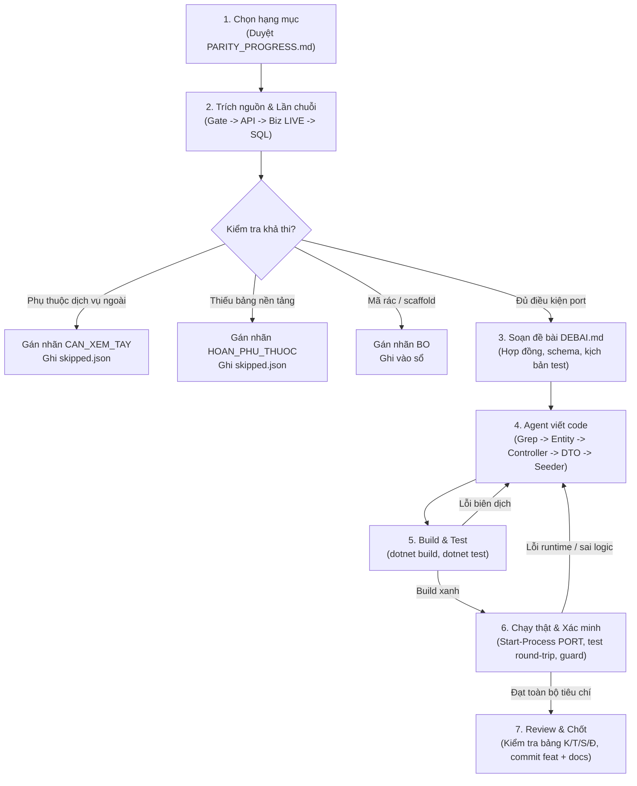
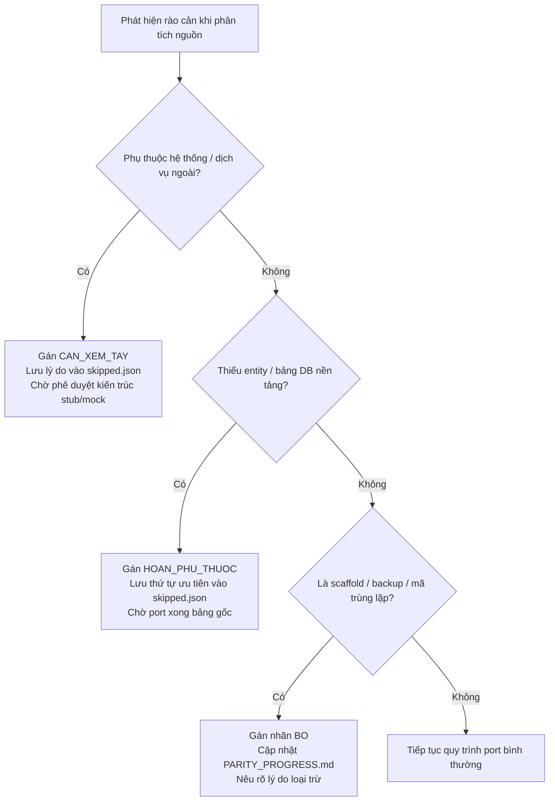

# QUY TRÌNH CHUẨN PORT 1-1 TỪ `2022.7.Loyalty` SANG MiniLoyalty

> **Phạm vi**: Toàn bộ chu trình port 1-1 các hạng mục Controller/Action từ giải pháp nguồn `2022.7.Loyalty` sang ứng dụng đích `MiniLoyalty`.  
> **Cập nhật**: 2026-10-16 11:15  
> **Nguồn dữ liệu**: `PORT_RULES_MiniLoyalty.md`, `repos\labs-audit\SOP_CONVERT_1TO1.md`, `repos\labs-audit\INDEX_CONVERT.md` (§5 bẫy), nhật ký thực tế tại `.parity-run\logs\`.  
> **Trạng thái**: Nháp — chờ review  

---

## 1. Mục đích và nguyên tắc cốt lõi

Tài liệu này chuẩn hóa toàn bộ các bước thực thi việc chuyển đổi (port) 1-1 từng endpoint, action nghiệp vụ từ hệ thống cũ (`2022.7.Loyalty`) sang kiến trúc hiện đại của `MiniLoyalty` (.NET 8, EF Core, SQLite/PostgreSQL).

### Nguyên tắc bất biến
1. **Một hạng mục mỗi lượt**: Mỗi phiên làm việc chỉ xử lý duy nhất 1 hạng mục. Cấm làm đồng thời nhiều hạng mục trong một commit code.
2. **Cô lập theo file riêng**: Mỗi bảng/controller port phải nằm trên một file riêng biệt (`Models/Port/<Bảng>.cs` và `Controllers/Port/<TênController>Port.cs`). Không sửa file dùng chung (`AppDbContext.cs`, `Program.cs`) khi không được giao rõ, tránh xung đột giữa các agent chạy song song.
3. **Đọc trọn vẹn chuỗi gọi LIVE**: Bắt buộc lần dấu vết đủ 4 tầng: `ClientGate` -> `WebAPI Service` -> `Biz API Controller` -> `Biz LIVE Method` -> `SQL thật`. Cấm dừng ở tầng Gate hoặc đọc nhầm mã chết (`Delete.*`, `*.sync-conflict-*.cs`, `*.bak`).
4. **Kiểm chứng bằng chạy thật (Runtime Verification)**: Build xanh (`0 Error(s)`) chỉ là điều kiện cần. Bắt buộc phải chạy tiến trình app thật, kiểm tra round-trip ghi dữ liệu, kiểm tra các ca chặn lỗi (guard), và đối chiếu bộ lọc truy vấn.
5. **Tuyệt đối an toàn thông tin**: Nghiêm cấm sao chép tài khoản, mật khẩu, token, chuỗi kết nối hardcode từ nguồn vào mã nguồn hoặc tài liệu dưới bất kỳ hình thức nào.

---

## 2. Sơ đồ luồng thực thi (Workflow)



---

## 3. Phân định vai trò & trách nhiệm

| Vai trò | Thành phần đảm nhiệm | Trách nhiệm chính |
|---|---|---|
| **Điều phối (Orchestrator)** | Claude / Quản trị viên | Chọn hạng mục tiếp theo từ sổ tiến độ; kiểm tra quan hệ phụ thuộc; phân bổ luồng cho các agent viết code; giám sát tiến độ toàn cục. |
| **Trích nguồn & Soạn đề bài** | Script `extract-source.ps1` (trích nguồn) / Điều phối hoặc Lead (soạn đề bài) | Script lần theo chuỗi gọi và xuất trích đoạn mã nguyên văn (`source_excerpt.txt`). `DEBAI.md` (đường dẫn tuyệt đối, chữ ký hàm, schema, con số kỳ vọng, yêu cầu kiểm thử) do Claude hoặc agent Lead (Claude Sonnet 5.5 qua agy, `lead.ps1`) soạn; không có script sinh đề bài tự động. |
| **Agent viết mã (Worker)** | `agy` (Gemini Flash), `CodeGPT` (DeepSeek) | Đọc hiểu trọn vẹn chuỗi nghiệp vụ; kiểm tra trùng lặp (`grep`); sinh mã entity, controller port, seeder; biên dịch `dotnet build`; chạy kiểm thử runtime cục bộ; xuất nhật ký `write_r*.txt`. |
| **Người duyệt (Reviewer)** | Claude Opus 5.5 | Soát xét độc lập toàn bộ diff; kiểm tra tính trung thực của bảng đối chiếu (K/T/S/Đ); rà soát an toàn dữ liệu; phê duyệt đạt chuẩn (`Review: PASS`) trước khi tạo commit. |
| **Quản lý quy trình & chất lượng** | `doc2` (Antigravity) | Đo lường số liệu thực tế bằng lệnh; lập ma trận truy vết; đăng ký và phân loại GAP; ghi nhận sổ tay bẫy lỗi; cập nhật báo cáo tiến độ độc lập. |

---

## 4. Bảy giai đoạn thực hiện chi tiết

### Giai đoạn 1: Lựa chọn hạng mục & Lập kế hoạch
1. Đọc sổ tiến độ `PARITY_PROGRESS.md`, tìm các hạng mục đang ở trạng thái `Chưa làm`.
2. Ưu tiên theo nhóm nghiệp vụ logic: hoàn thành dứt điểm các controller danh mục cơ sở (`Mst_*`) trước khi chuyển sang bảng trung gian (`Map_*`), giao dịch thẻ (`Crd_*`), khuyến mại (`Prm_*`), hoặc báo cáo (`Rpt_*`).
3. Kiểm tra các điều kiện tiên quyết: bảng phụ thuộc đã có entity và migration chưa. Nếu chưa có bảng cha, chuyển sang tiêu chí tạm hoãn (`HOAN_PHU_THUOC`).

### Giai đoạn 2: Trích nguồn & Lần chuỗi gọi
1. Bắt đầu từ file Gate: `D:\idocNet\2022.7.Loyalty\13.ClientGate\V10\idn.Loyalty.WebAPI\Controllers\<Tên>Controller.cs`.
2. Xác định phương thức API backend tương ứng: qua lời gọi `WA_<Tên>_<Action>`.
3. Lần tới file Controller Backend: `11.BackEnd\V10\idn.Loyalty.Biz.Web\Controllers\<Tên>Controller.cs`.
4. Tìm hàm nghiệp vụ xử lý tại `idn.Loyalty.Biz\*.cs`:
   - Phải xác định đúng **bản LIVE** đang được hàm controller gọi thực tế (ví dụ: `_New2025...`, `_New2026...`).
   - Tuyệt đối loại bỏ các bản chết: file `Delete.*`, file xung đột đồng bộ `*.sync-conflict-*.cs`, file sao lưu `*.bak`.
5. Đọc SQL thực thi: kiểm tra danh sách bảng nguồn, các cột được chọn hoặc cập nhật, điều kiện lọc `WHERE`, các phép kiểm tra logic (`throw`, mã lỗi nghiệp vụ).

### Giai đoạn 3: Soạn đề bài chi tiết (`DEBAI.md`)
Đề bài giao cho agent viết code bắt buộc gồm 5 phần cấu trúc:
1. **Đường dẫn tuyệt đối**: Vị trí file nguồn (Gate, API, Biz, DDL) và file đích được phép ghi trong repo.
2. **Đặc tả hợp đồng API**: Route URL (dạng `/api/<tên-viết-thường>/<action>`), phương thức HTTP (chuẩn POST), cấu trúc Request Body / DTO.
3. **Mô hình thực thể & Cơ sở dữ liệu**: Tên bảng nguồn, danh sách cột, kiểu dữ liệu, khóa chính (`HasKey`), quan hệ khóa ngoại (nếu có).
4. **Danh sách Guard & Validation**: Điều kiện kiểm tra dữ liệu đầu vào, mã lỗi trả về (`Success = false`, `ErrorCode`).
5. **Kịch bản kiểm thử Runtime**: Tối thiểu 1 ca round-trip ghi-đọc thành công và 1 ca vi phạm guard trả lỗi đúng chuẩn.

### Giai đoạn 4: Viết mã nguồn (DoD bước 1 - 5)
1. **Bước 1 - Grep trước**: Quét toàn bộ repo đích xem endpoint/bảng đã tồn tại chưa (`grep -rn "<Tên>"`). Nếu đã có, không sửa mã, báo cáo `DA_CO`.
2. **Bước 2 - Mô hình thực thể (`Models/Port/<Bảng>.cs`)**:
   - Khai báo lớp entity trong `namespace MiniLoyalty.Models.Port`.
   - Cấu hình Fluent API qua `IEntityTypeConfiguration<T>` trong cùng file (`ToTable("<TênBảng>")`, `HasKey(...)`).
   - Không khai báo `DbSet` trong `AppDbContext.cs`; sử dụng `db.Set<T>()`.
   - Tạo class Seeder `<TênBảng>Seeder : IPortSeeder` sinh dữ liệu mẫu tối thiểu (idempotent).
3. **Bước 3 - Controller Port (`Controllers/Port/<Tên>Port.cs`)**:
   - Đặt attribute `[ApiController]`, route `/api/<tên-controller-thường>/<action>`.
   - Action nhận 1 body DTO duy nhất (Minimal API pattern).
4. **Bước 4 - Chuẩn hóa dữ liệu nguồn**:
   - Áp dụng đúng hàm: `StdParam(x)` (Trim + ToUpper), `StdStr(x)` (Trim + Normalize), `StdFlag(x)` ("1" nếu "1", ngược lại "0").
   - Kiểu số: dùng `double?` cho các trường tính toán hoặc tiền tệ nguồn (`MyValue`), tránh lỗi `SUM()` trên kiểu TEXT của SQLite.
   - So khớp chuỗi: bắt buộc dùng `EF.Functions.Like(cột.ToLower(), pattern, "\\")` với pattern đã xử lý `ToLower()` và escape ký tự đặc biệt, đảm bảo hành vi không phân biệt hoa/thường (Case-Insensitive) tương thích SQL Server.
5. **Bước 5 - Lập bảng đối chiếu K/T/S/Đ**:
   - `K`: Khớp hoàn toàn với nguồn.
   - `T`: Thiếu (nêu rõ lý do thiếu cột/bảng liên quan).
   - `S`: Khác nguồn (đã khai báo lý do điều chỉnh kỹ thuật).
   - `Đ`: Đơn giản hóa có chủ đích (ví dụ: lược bỏ ghi log ngoài hoặc bypass phân quyền chưa port).

### Giai đoạn 5: Build, Test & Kiểm thử thực tế Runtime (DoD bước 6)
1. **Biên dịch**: `dotnet build -c Release` đạt `0 Error(s)`.
2. **Kiểm thử đơn vị**: `dotnet test MiniLoyalty.Tests -c Release` toàn bộ pass.
3. **Chạy ứng dụng thật**:
   - Thiết lập cổng chạy riêng biệt qua biến `$env:PORT` (vì app cấu hình `UseUrls` ghi đè `ASPNETCORE_URLS`).
   - Tạo database SQLite tạm thời tại thư mục Temp.
   - Khởi động ứng dụng độc lập qua PowerShell:
     ```powershell
     $p = Start-Process dotnet 'bin\Release\net8.0\MiniLoyalty.dll' -PassThru -WindowStyle Hidden
     ```
   - Chờ ứng dụng sẵn sàng bằng vòng lặp kiểm tra endpoint `/healthz` (tối đa 30 lần, mỗi lần nghỉ 1 giây). Tuyệt đối không đọc `StandardOutput.ReadLine()` tránh treo vô hạn do đệm luồng stdout (Bẫy #44).
4. **Thực thi các ca kiểm thử**:
   - Với action GHI: Gửi payload hợp lệ -> kiểm tra kết quả trả về `Success = true` -> truy vấn lại dữ liệu đảm bảo khớp giá trị (round-trip); gửi payload vi phạm guard -> kiểm tra hệ thống trả lỗi đúng mã.
   - Với action ĐỌC: Gửi tối thiểu 2 bộ lọc khác nhau -> xác nhận số lượng bản ghi trả về phân hóa đúng logic nghiệp vụ.
5. **Dọn dẹp tài nguyên**: Tắt tiến trình ứng dụng (`Stop-Process -Id $p.Id -Force`), đóng cổng mạng, và xóa tệp database tạm.

### Giai đoạn 6: Review & Đánh giá an toàn
1. Reviewer độc lập (Claude) kiểm tra diff git (`git diff`).
2. Xác minh không có thông tin đăng nhập, token hệ thống bị lọt vào code hoặc comment.
3. Đánh giá tính xác thực của kết quả kiểm thử runtime trong file log `write_r*.txt`.
4. Nếu phát hiện sai sót, yêu cầu agent viết lại round tiếp theo (`write_r1`, `write_r2`). Khi đạt toàn bộ tiêu chí, cấp cờ `Review: PASS`.

### Giai đoạn 7: Chốt kết quả & Ghi nhận sổ tiến độ
1. Tạo commit mã nguồn: `feat(parity): port 1-1 <Controller>/<Action> ...` kèm thông tin định danh engine thực hiện.
2. Tạo commit tài liệu: `docs(parity): <Controller>/<Action> -> Đã làm (X/337 (P%))`.
3. Cập nhật dòng tương ứng trong `PARITY_PROGRESS.md` từ `Chưa làm` sang `Đã làm` kèm hash commit.
4. Lưu trữ toàn bộ nhật ký phiên chạy tại `.parity-run\logs\<số>_<hạng-mục>\`.

---

## 5. Tiêu chí hoàn thành (Definition of Done - DoD)

Một hạng mục chỉ được công nhận là `Đã làm` khi thỏa mãn đầy đủ 7 tiêu chí:
- [x] **DoD 1 - Không trùng lặp**: Đã grep xác nhận chưa từng được port trước đó trong repo đích.
- [x] **DoD 2 - Đúng nguồn sống**: Lần đúng chuỗi gọi tới hàm Biz LIVE đang chạy, không tham chiếu mã chết.
- [x] **DoD 3 - Đầy đủ cấu trúc**: Entity + Fluent API + Controller Port + DTO + Seeder được tạo đúng quy ước thư mục riêng biệt.
- [x] **DoD 4 - Chuẩn hóa chuẩn mực**: Áp dụng đúng các quy ước kỹ thuật (`StdParam`/`StdStr`/`StdFlag`, `double?`, `EF.Functions.Like`, Minimal API 1 DTO).
- [x] **DoD 5 - Bảng đối chiếu minh bạch**: Có bảng phân loại K/T/S/Đ chi tiết cho từng tham số đầu vào, cột dữ liệu và guard nghiệp vụ.
- [x] **DoD 6 - Chạy thật đạt 100%**: Ứng dụng đã chạy thực tế trên cổng mạng riêng; có bằng chứng lệnh gọi HTTP curl/Invoke-RestMethod; đạt round-trip thành công và bắt lỗi guard đúng chuẩn; đã dọn dẹp tiến trình và DB tạm.
- [x] **DoD 7 - Review độc lập chấp thuận**: Được reviewer kiểm duyệt diff, xác nhận không lộ credentials, và phê duyệt commit.

---

## 6. Tiêu chí phân loại bỏ qua & tạm hoãn

Khi một hạng mục không thể hoàn tất theo quy trình thông thường, điều phối viên phân loại vào 1 trong 3 trạng thái sau và lưu vết tại `.parity-run\skipped.json`:



### 1. `CAN_XEM_TAY` (Cần con người quyết định kiến trúc)
Áp dụng khi logic nguồn phụ thuộc vào dịch vụ bên thứ ba hoặc hệ thống ngoại vi mà `MiniLoyalty` chưa có sandbox hoặc hạ tầng kết nối:
- Gọi API Master Server ngoại vi (ví dụ: `WA_OS_Inos_Org_GetMyOrgList` của iNOS).
- Gọi Web Service ghi dữ liệu sang hệ thống DMS khác (ví dụ: `WSDMS CarSv_Ser_CustomerCar_Get` ghi dữ liệu xe sang DMS Hyundai làm ảnh hưởng giao dịch).
- Đòi hỏi quyết định từ người dùng: xây dựng mock/stub nội bộ, kết nối API thật, hay chấp nhận ghi nhận GAP.

### 2. `HOAN_PHU_THUOC` (Hoãn do phụ thuộc thứ tự)
Áp dụng khi endpoint yêu cầu ghi hoặc kiểm tra khóa ngoại trên các bảng lớn phức tạp chưa được chuyển đổi:
- Yêu cầu bảng `Mst_NNT` với hơn 60 cột thông tin doanh nghiệp mạng lưới.
- Yêu cầu hệ thống phân quyền chi tiết người dùng `Sys_User` (hàm kiểm tra `Sys_User_GetAbilityViewOfUser`).
- Xử lý: Hoãn lại và quay lại thực hiện sau khi các bảng nền tảng đã được port và kiểm thử hoàn chỉnh.

### 3. `BO` (Loại bỏ khỏi phạm vi chuyển đổi)
Áp dụng cho các thành phần không mang giá trị nghiệp vụ vận hành:
- Các endpoint scaffold sinh tự động của framework (`HelpPage`, `/Shared/`).
- Các action sao lưu cũ của lập trình viên còn sót lại trong mã nguồn (ví dụ: `Mst_OrgController/GetAllOrg_bk`).
- Xử lý: Đánh dấu trạng thái `Bỏ` trong sổ tiến độ kèm lý do minh bạch, không tính vào khối lượng công việc tồn đọng.

---

## 7. Các điều cấm tuyệt đối (Zero Tolerance)

1. **Cấm rò rỉ thông tin bảo mật**: Tuyệt đối không chép tài khoản, mật khẩu, private key, token, connection string vào code, comment hay tài liệu. Vi phạm sẽ bị hủy bỏ toàn bộ kết quả lượt làm việc.
2. **Cấm tự ý thao tác Git**: Agent viết code không được tự ý chạy các lệnh `git commit`, `git push`, `git checkout`, `git switch`, `git reset`, `git clean` hoặc chuyển đổi nhánh.
3. **Cấm can thiệp sổ tiến độ**: Không tự ý sửa đổi file `PARITY_PROGRESS.md`. Quyền cập nhật sổ tiến độ thuộc về bước điều phối sau khi đã có commit hợp lệ.
4. **Cấm sửa ngoài phạm vi cho phép**: Không ghi đè các file dùng chung (`AppDbContext.cs`, `Program.cs`) trừ khi có chỉ thị rõ ràng. Không ghi bất kỳ dữ liệu nào vào thư mục nguồn `D:\idocNet`.
5. **Cấm báo cáo khống (Over-claim)**: Chưa chạy kiểm thử runtime thực tế thì chỉ được ghi nhận `verify PENDING`, không được tự nhận là hoàn thành.

---

## 8. Lịch sử cập nhật

| Phiên bản | Ngày cập nhật | Người thực hiện | Nội dung thay đổi |
|---|---|---|---|
| 1.0 | 2026-10-16 11:15 | doc2 (Quản lý quy trình) | Khởi tạo tài liệu quy trình chuẩn port 1-1 cho MiniLoyalty; tích hợp các bài học từ SOP_CONVERT_1TO1 và INDEX_CONVERT §5. |
